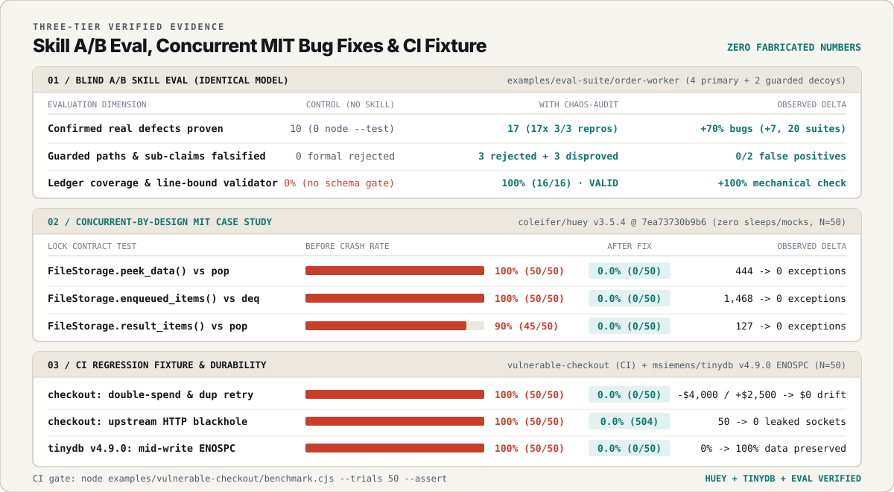

# Before & After Chaos Benchmarks (`examples/vulnerable-checkout`)

Measured by running [`examples/vulnerable-checkout/benchmark.cjs`](../examples/vulnerable-checkout/benchmark.cjs) against our **synthetic deterministic CI reference fixture** over loopback `127.0.0.1` ([`server.js`](../examples/vulnerable-checkout/server.js) **Before** vs. [`fixed-server.js`](../examples/vulnerable-checkout/fixed-server.js) **After**), with raw JSON telemetry saved in [`examples/benchmark-results/before-after.json`](../examples/benchmark-results/before-after.json). (For blind skill evaluation and real-world concurrent MIT bug studies, see [`EVAL.md`](EVAL.md) and [`CASE-STUDY-HUEY.md`](CASE-STUDY-HUEY.md).)

<p align="center">
  
</p>

## Benchmark Environment

| Parameter | Recorded Value |
|---|---|
| **Trials per Scenario** | `50` (`150` total checkout chaos trials) |
| **Runtime & OS** | Node `v26.13.1` · `win32` / `x64` (`16` CPUs) |
| **Total Wall-Clock Time** | `5,072 ms` (`~5.1 s`) |
| **Raw Telemetry** | [`examples/benchmark-results/before-after.json`](../examples/benchmark-results/before-after.json) |
| **Sample Audit Bundle** | [`examples/sample-audit-output/REPORT.md`](../examples/sample-audit-output/REPORT.md) |

---

## Side-by-Side Before & After Results (`N = 50` / Scenario)

### 1. Concurrent Double-Spend (`POST /checkout` · `toctou_race`)
Per trial: user wallet initialized to `$100`; two concurrent `$80` checkout requests dispatched via `Promise.all` across batches of 5 independent users.

| Metric | Before (`server.js`) | After (`fixed-server.js`) |
|---|---:|---:|
| **Invariant Violation Rate** | `100%` (`50/50`) | **`0%` (`0/50`)** |
| **Unauthorized Spend Drift** | `-$4,000` (`$3,000` overdraft debt) | **`$0`** |
| **Min Wallet Balance Observed** | `-$60` | **`$20`** |
| **HTTP Status Counts (`100` reqs)** | `100x 200 OK` | **`50x 200 OK` · `50x 409 Conflict`** |
| **Request Latency (`p50` / `p95` / `p99` / `max`)** | `59.54` / `112.92` / `113.91` / `146.24 ms` | `61.94` / `91.33` / `98.01` / `98.26 ms` |

### 2. Duplicate Payment Webhook Replay (`POST /webhooks/payment` · `non_idempotent_retry`)
Per trial: user wallet initialized to `$0`; two concurrent `$50` webhook deliveries with the exact same `eventId` dispatched concurrently.

| Metric | Before (`server.js`) | After (`fixed-server.js`) |
|---|---:|---:|
| **Invariant Violation Rate** | `100%` (`50/50`) | **`0%` (`0/50`)** |
| **Duplicate Credit Drift** | `+$2,500` | **`$0`** |
| **Max Wallet Balance Observed** | `$100` (`2x` credit) | **`$50` (`1x` credit)** |
| **HTTP Status Counts (`100` reqs)** | `100x 200 OK` | `100x 200 OK` (`duplicate: true` on replay) |
| **Request Latency (`p50` / `p95` / `p99` / `max`)** | `29.86` / `48.29` / `48.45` / `48.63 ms` | `21.12` / `48.09` / `61.53` / `62.10 ms` |

### 3. Upstream Stall / Missing Timeout (`GET /recommendations` · `missing_timeout`)
Per trial: upstream local TCP blackhole server accepts socket connections and never sends response headers or bytes; requests dispatched in batches of `10`. Before uses a `300 ms` client watchdog; After configures `upstreamTimeoutMs: 120` with graceful `504` fallback.

| Metric | Before (`server.js`) | After (`fixed-server.js`) |
|---|---:|---:|
| **Unbounded Hang Rate** | `100%` (`50/50`) | **`0%` (`0/50`)** |
| **Graceful `504` Fallback Rate** | `0%` (`0/50`) | **`100%` (`50/50`)** |
| **Leaked Upstream TCP Sockets** | `50` | **`0`** |
| **Outcome Counts (`50` reqs)** | `50x TimeoutError` (`300 ms` watchdog) | **`50x 504` (`fallback_items: []`)** |
| **Request Latency (`p50` / `p95` / `p99` / `max`)** | `307.95` / `313.12` / `313.22` / `313.22 ms` | `129.14` / `144.05` / `144.64` / `144.64 ms` |

---

## Reproduce Locally (Zero Dependencies)

```bash
# Run N=50 trials per scenario, enforce invariants, and print summary
node examples/vulnerable-checkout/benchmark.cjs --trials 50 --assert

# Or regenerate the raw JSON telemetry file
node examples/vulnerable-checkout/benchmark.cjs --trials 50 --out examples/benchmark-results/before-after.json --assert
```
