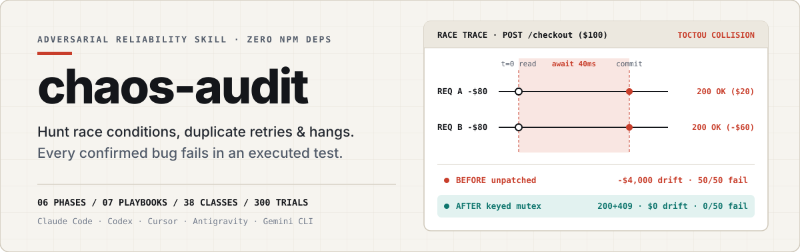

<p align="center">
  
</p>

<h1 align="center">chaos-audit (Deutsch)</h1>

<p align="center">
  <a href="../README.md">English</a> ·
  <a href="README.zh-CN.md">简体中文</a> ·
  <a href="README.ja.md">日本語</a> ·
  <a href="README.ko.md">한국어</a> ·
  <a href="README.tr.md">Türkçe</a> ·
  <a href="README.es.md">Español</a> ·
  <a href="README.fr.md">Français</a> ·
  <b>Deutsch</b> ·
  <a href="README.pt-BR.md">Português</a> ·
  <a href="README.vi.md">Tiếng Việt</a> ·
  <a href="README.ru.md">Русский</a>
</p>

<p align="center">
  <b>Dein Coding-Agent hat das Feature in 10 Minuten gebaut. Hat er auch eine Double-Spend-Race-Condition mitgeliefert?</b><br>
  Ein sechsstufiger, adversarieller Zuverlässigkeits- und Chaos-Engineering-Skill für Claude Code, Codex, Cursor und Google Antigravity.<br>
  Jeder <code>confirmed</code>-Befund muss einen Gegenprüfer überstehen und durch einen deterministisch fehlschlagenden Reproducer-Test belegt sein.
</p>

<p align="center">
  
</p>

## Was `chaos-audit` findet

- **TOCTOU-Race-Conditions**: Lesen → `await` → Schreiben ohne Sperre oder CAS-Prüfung.
- **Nicht-idempotente Webhooks & Queues**: Doppelte Gutschriften bei wiederholter `eventId`-Zustellung.
- **Fehlende HTTP-Timeouts & Pool-Erschöpfung**: Hängende Worker bei blockierten Downstream-APIs.
- **Datenbank-Deadlocks, Write Skew und nicht-atomare Schreibvorgänge.**
- **Fehler in KI-Agenten-Pipelines**: Mehrfache Tool-Ausführung und MCP-`stdio`-Deadlocks.

## Installation & lokale Tests

```bash
npx skills add https://github.com/Treamyracle/chaos-audit-skill --skill chaos-audit
```

```bash
node --test skills/chaos-audit/validate-fault-ledger.test.cjs skills/chaos-audit/validate-findings.test.cjs
node --test examples/vulnerable-checkout/reproducers/*.repro.test.cjs
```

Details und Verifizierungsstatus stehen in der [englischen Haupt-README](../README.md) und in [STATUS.md](../docs/STATUS.md) ([MIT-Lizenz](../LICENSE)).
