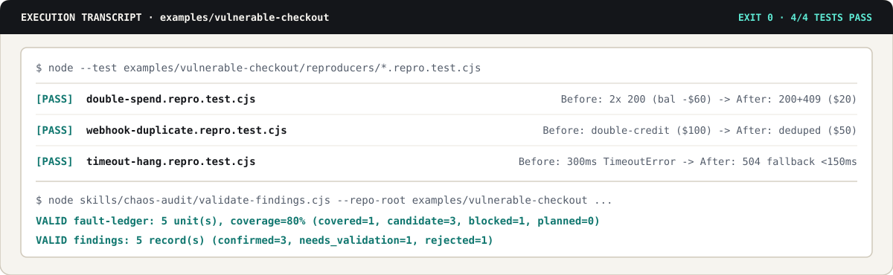

<p align="center">
  
</p>

<h1 align="center">chaos-audit (Português)</h1>

<p align="center">
  <a href="../README.md">English</a> ·
  <a href="README.zh-CN.md">简体中文</a> ·
  <a href="README.ja.md">日本語</a> ·
  <a href="README.ko.md">한국어</a> ·
  <a href="README.tr.md">Türkçe</a> ·
  <a href="README.es.md">Español</a> ·
  <a href="README.fr.md">Français</a> ·
  <a href="README.de.md">Deutsch</a> ·
  <b>Português</b> ·
  <a href="README.vi.md">Tiếng Việt</a> ·
  <a href="README.ru.md">Русский</a>
</p>

<p align="center">
  <b>Seu agente de código entregou a feature em 10 minutos. Ele também entregou uma race condition de gasto duplo?</b><br>
  Uma skill de engenharia de confiabilidade e caos adversarial em 6 fases para Claude Code, Codex, Cursor e Google Antigravity.<br>
  Todo achado <code>confirmed</code> precisa sobreviver a um verificador adversarial e ser provado por um teste reprodutor determinístico.
</p>

<p align="center">
  
</p>

## O que o `chaos-audit` detecta

- **Condições de corrida TOCTOU**: leitura antes de um `await` seguida de gravação sem lock nem CAS.
- **Webhooks e filas não idempotentes**: reenvios com o mesmo `eventId` creditando ou cobrando duas vezes.
- **Chamadas HTTP sem timeout**: travamento indefinido de workers quando um serviço externo congela.
- **Deadlocks de banco, write skew e gravações não atômicas em disco.**
- **Falhas em pipelines de agentes LLM**: chamadas de ferramentas duplicadas e deadlocks de `stdio` MCP.

## Instalação e testes locais

```bash
npx skills add https://github.com/Treamyracle/chaos-audit-skill --skill chaos-audit
```

```bash
node --test skills/chaos-audit/validate-fault-ledger.test.cjs skills/chaos-audit/validate-findings.test.cjs
node --test examples/vulnerable-checkout/reproducers/*.repro.test.cjs
```

Veja os detalhes completos no [README principal em inglês](../README.md) e o status em [STATUS.md](../docs/STATUS.md) ([Licença MIT](../LICENSE)).
